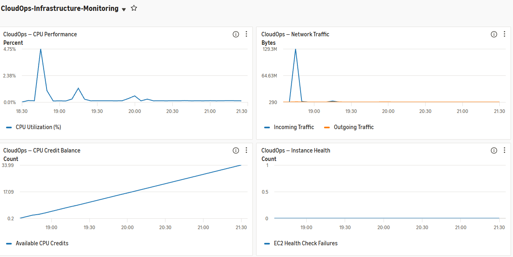

# CloudOps — AWS Cloud Engineering & DevOps Portfolio

A hands-on cloud engineering and DevOps project demonstrating the deployment, security, monitoring, and automated delivery of a Python web application on Amazon Web Services (AWS).

CloudOps was developed to gain practical experience in cloud infrastructure, Linux system administration, networking, application deployment, infrastructure security, and CI/CD automation.

**Live Application:** https://cloudops-portfolio.duckdns.org

**Health Check API:** https://cloudops-portfolio.duckdns.org/health

**Project Status:** Active Development — Core Infrastructure and CI/CD Pipeline Operational

---

## Project Overview

CloudOps is a Python Flask web application deployed on an Amazon EC2 instance running Ubuntu 26.04 LTS.

The infrastructure uses Nginx as a reverse proxy, Gunicorn as the application server, and AWS CloudWatch for infrastructure monitoring.

The project includes a GitHub Actions CI/CD pipeline that automates application testing and supports controlled deployments to AWS EC2 using OpenID Connect (OIDC) authentication and AWS Systems Manager.

The objective is to demonstrate a practical understanding of cloud architecture, secure infrastructure management, deployment automation, and operational reliability.

## System Architecture

**Application Request Flow:**

Client Browser → AWS EC2 Security Group → Nginx (HTTPS) → Gunicorn → Flask Application

**Deployment Flow:**

GitHub Repository → GitHub Actions → Automated Tests → AWS OIDC Authentication → AWS Systems Manager → EC2 Deployment → Health Verification

### Infrastructure Components

| Technology | Purpose |
|---|---|
| Amazon EC2 | Cloud virtual machine hosting the application |
| Ubuntu 26.04 LTS | Linux operating system |
| AWS VPC | Virtual networking and network isolation |
| EC2 Security Groups | Inbound and outbound traffic control |
| Nginx | Reverse proxy, HTTPS termination and HTTP redirection |
| Gunicorn | Python WSGI application server |
| Python / Flask | Web application and REST-style health-check endpoint |
| AWS CloudWatch | Infrastructure performance and health monitoring |
| AWS IAM | Role-based access control |
| AWS Systems Manager | Remote server management and command execution |
| GitHub Actions | Automated testing and deployment orchestration |
| GitHub OIDC | Secure AWS authentication using temporary credentials |
| Let's Encrypt / Certbot | TLS certificates and renewal |

---

## Infrastructure Deployment

Provisioned and configured an Amazon EC2 instance to host the CloudOps application.

### Implemented Features

- Launched and configured an EC2 instance in the AWS Europe (Ireland) region.
- Installed and configured Ubuntu Linux.
- Configured VPC networking and EC2 security group rules.
- Established remote server administration using SSH key authentication.
- Configured an isolated Python virtual environment.
- Developed and deployed a Python Flask application.
- Configured Gunicorn as the WSGI application server.
- Created a systemd service to manage the application.
- Configured Nginx to reverse-proxy incoming requests to Gunicorn.
- Configured public DNS using DuckDNS.
- Enabled HTTPS encryption using Let's Encrypt.
- Implemented application health checks.

### Application Health API

The `/health` endpoint returns a JSON response indicating application status.

Example response:

`{"service":"cloudops","status":"healthy","timestamp":"2026-11-21T23:01:21+00:00"}`

The endpoint is used for application availability verification and post-deployment health checks.

---

## Infrastructure Monitoring — AWS CloudWatch

Created a custom Amazon CloudWatch dashboard to monitor the performance and operational health of the EC2 instance.

### Monitored Metrics

- **CPU Utilization:** Tracks average processor usage over five-minute intervals.
- **Network Traffic:** Monitors incoming and outgoing network activity.
- **CPU Credit Balance:** Tracks accumulated CPU credits available for burstable instance performance.
- **Instance Health:** Monitors EC2 status-check failures.

### CloudWatch Dashboard

The monitoring dashboard provides visibility into resource utilization, network activity, and infrastructure health.

These metrics support performance analysis and infrastructure troubleshooting.

---

## HTTPS and Infrastructure Security

Implemented HTTPS encryption and foundational infrastructure security controls.

### Security Features

- TLS encryption using Let's Encrypt certificates.
- HTTP-to-HTTPS redirection through Nginx.
- Automated certificate renewal configured and tested.
- SSH key-based authentication for remote administration.
- Restricted SSH access through EC2 security groups.
- Role-based AWS permissions using IAM.
- Gunicorn configured behind the Nginx reverse proxy.
- Sensitive local files excluded from Git tracking through `.gitignore`.
- Temporary AWS credentials for GitHub Actions through OIDC authentication.

### Secure Public Access

**Website:** https://cloudops-portfolio.duckdns.org

**Health Check:** https://cloudops-portfolio.duckdns.org/health

---

## CI/CD Pipeline — GitHub Actions

Implemented a GitHub Actions pipeline to automate application testing and coordinate deployments to AWS EC2.

The deployment workflow is currently triggered manually from GitHub Actions to maintain control over production updates.

### Continuous Integration (CI)

The CI pipeline performs the following operations:

1. Checks out application source code from GitHub.
2. Configures the Python execution environment.
3. Installs application dependencies.
4. Runs automated tests using pytest.
5. Reports test results through GitHub Actions.

Automated tests verify the Flask homepage and application health-check endpoint.

### Continuous Delivery (CD)

The deployment workflow performs the following operations:

1. Triggers deployment manually from GitHub Actions.
2. Executes automated Python tests.
3. Authenticates to AWS using GitHub OIDC.
4. Obtains temporary AWS credentials through IAM role assumption.
5. Sends a deployment command through AWS Systems Manager.
6. Retrieves the specified GitHub commit on the EC2 instance.
7. Creates a backup of the existing application file.
8. Updates the deployed Flask application.
9. Restarts the application using systemd.
10. Performs application health checks with retry logic.
11. Verifies the public HTTPS health endpoint.
12. Reports the deployment result in GitHub Actions.

### Deployment Security

The pipeline uses security controls including:

- GitHub OIDC authentication without permanent AWS access keys.
- IAM trust conditions restricting role assumption to the authorized GitHub repository and `main` branch.
- Systems Manager permissions scoped to the target EC2 instance and command document.
- Remote execution without storing the EC2 SSH private key in GitHub.
- Deployment serialization to prevent overlapping deployments.
- Application backup before deployment.
- Dependency-change detection requiring manual review.
- Local application-file rollback logic when deployment or local health verification fails.

The current rollback mechanism is limited to the Flask application file and has not yet been fully failure-tested. Complete infrastructure and database rollback are outside the scope of the current implementation.

### Verified Deployment

Successfully tested an end-to-end deployment from GitHub Actions to the live EC2 environment.

A homepage modification was committed to GitHub, deployed through the CI/CD pipeline, and verified on the publicly accessible application.

**Deployment Result:** Successful

**Deployment Trigger:** Manual GitHub Actions workflow

**Application:** https://cloudops-portfolio.duckdns.org

---

## AWS Systems Manager Integration

Configured AWS Systems Manager to securely administer the EC2 instance.

### Implemented Capabilities

- Installed and configured the AWS Systems Manager Agent.
- Assigned an IAM instance role with the required Systems Manager permissions.
- Registered the EC2 instance as an online managed node.
- Verified remote command execution using AWS Run Command.
- Integrated Systems Manager with GitHub Actions for application deployments.

This enables remote infrastructure administration and deployment operations without requiring direct SSH access from GitHub Actions.

---

## Repository Structure

| Path | Description |
|---|---|
| `app.py` | Flask application and health-check API |
| `requirements.txt` | Python application dependencies |
| `tests/` | Automated application tests |
| `.github/workflows/python-tests.yml` | Python CI testing workflow |
| `.github/workflows/aws-oidc-check.yml` | AWS OIDC authentication verification |
| `.github/workflows/ec2-command-test.yml` | GitHub-to-EC2 remote execution verification |
| `.github/workflows/deploy.yml` | AWS EC2 deployment workflow |
| `docs/screenshots/` | Infrastructure documentation and screenshots |
| `.gitignore` | Local file and sensitive-file exclusions |
| `README.md` | Project documentation |

The live deployment script currently resides on the EC2 instance at `/usr/local/sbin/cloudops-deploy`. Version-controlling and testing this script is a planned improvement.

---

## Completed Milestones

- [x] Provision AWS EC2 infrastructure.
- [x] Configure Ubuntu Linux and SSH access.
- [x] Deploy Python Flask application.
- [x] Configure Gunicorn and Nginx.
- [x] Implement application health-check API.
- [x] Configure DNS and HTTPS.
- [x] Test TLS certificate renewal.
- [x] Create custom CloudWatch monitoring dashboard.
- [x] Create GitHub repository and project documentation.
- [x] Implement automated Python testing.
- [x] Configure GitHub Actions OIDC authentication with AWS.
- [x] Integrate AWS Systems Manager.
- [x] Verify remote command execution.
- [x] Implement manually triggered CI/CD deployment workflow.
- [x] Successfully deploy and verify a live application update.

---

## Development Roadmap

### Infrastructure as Code

- [ ] Implement Terraform configurations.
- [ ] Define EC2, VPC, security groups, and IAM resources as code.
- [ ] Improve infrastructure reproducibility.
- [ ] Establish safe Terraform state management.

### CI/CD Improvements

- [ ] Add controlled automatic deployment triggers.
- [ ] Implement GitHub deployment environments and approval controls.
- [ ] Version-control the EC2 deployment script.
- [ ] Test deployment failure and rollback scenarios.
- [ ] Improve deployment logs and error reporting.
- [ ] Introduce additional automated tests.

### Monitoring and Reliability

- [ ] Configure CloudWatch alarms.
- [ ] Improve application-level availability monitoring.
- [ ] Add deployment notifications.
- [ ] Expand operational documentation.
- [ ] Review infrastructure costs and resource utilization.

### Security Enhancements

- [ ] Introduce automated dependency vulnerability scanning.
- [ ] Add secret scanning and additional repository security checks.
- [ ] Review IAM permissions for least-privilege access.
- [ ] Implement additional infrastructure hardening.
- [ ] Document security controls and operational procedures.

---

## Skills Demonstrated

**Cloud Computing:** AWS EC2, VPC, IAM, CloudWatch, Systems Manager

**Operating Systems:** Ubuntu Linux, System Administration, systemd

**Networking:** TCP/IP, DNS, HTTPS, TLS, SSH, Security Groups, Reverse Proxies

**Software Development:** Python, Flask, REST-style APIs, Automated Testing

**DevOps:** Git, GitHub, GitHub Actions, CI/CD, Deployment Automation, OIDC Authentication

**Infrastructure Operations:** Server Configuration, Monitoring, Troubleshooting, Deployment Verification, Application Backup and Recovery

---

## Project Purpose

CloudOps is an independently developed cloud engineering portfolio project created to strengthen practical knowledge of AWS infrastructure, Linux administration, secure application hosting, monitoring, and deployment automation.

The project emphasizes hands-on implementation, technical problem-solving, infrastructure security, and operational practices.

It serves as an evolving demonstration of practical cloud engineering and DevOps capabilities, with future development focused on Infrastructure as Code, reliability, security, and automation.
